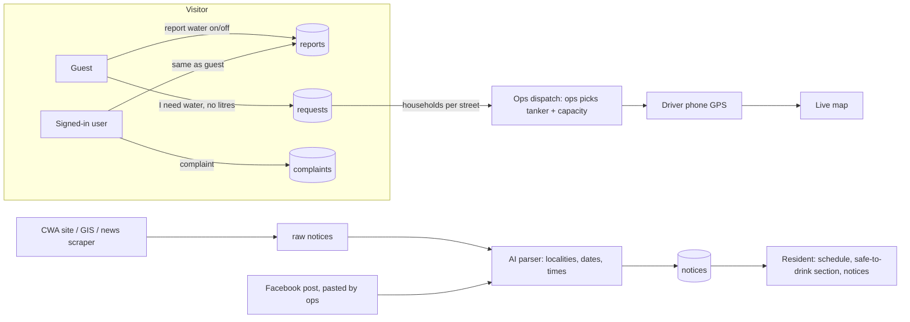
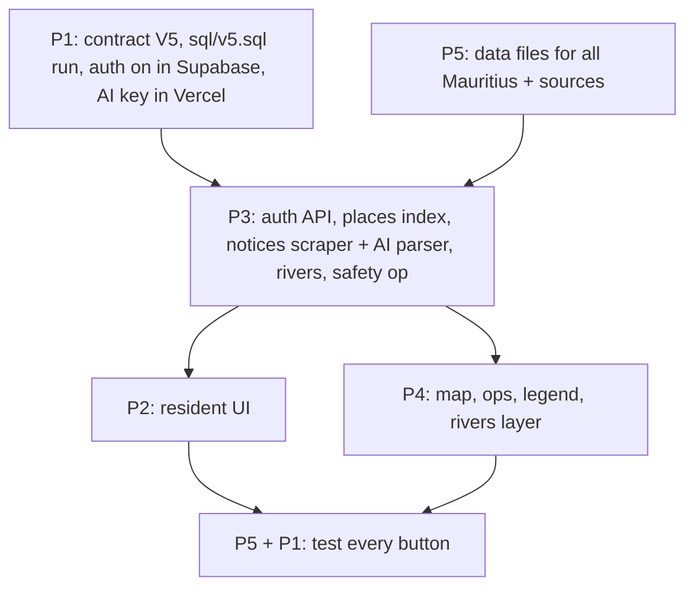

# Split V5 — Kot Delo? (P1, Fri 13 Nov night)

Supersedes the open parts of `docs/NEXT-TASK-SPLIT.md`. Rules for this round: `contracts/api.md` "V5". Why: `docs/DECISIONS.md` #11 to #16.

**Everyone, before you start:** `git pull origin main`, `git merge main` into your branch, read CLAUDE.md + contracts V5 + your section below.
**Use the AI-unslop skill on every change** (`antislop`, or `antislop-ui` / `antislop-copywriting` / `antislop-code` if you have them). UI text short, plain English, no filler paragraphs, no "Kot Delo? never judges..." essays. One line per disclaimer, max.
Each item = one small commit. Run it on a phone width (360 px) before you commit. Update your DONE.md + HANDOFF.md.

## Where we are (checked on main, d92ec17)

- Supabase is loaded: 6 areas, 21 streets, 156 schedule rows, 136 reservoir rows, 7 days of demo reports (`is_demo = true`).
- P2's onboarding tour, `/guide`, glass and motion pass are merged (#27).
- Problems found: data is Vacoas/Phoenix/Curepipe only; residents pick litres on a request (not allowed now); Report and Request share one tab; the reservoir "Watch" chip looks like a button but does nothing; the map draws up to three circles per street with no legend; the CWA notices box is buried in disclaimer text; no water-safety section, no reminder, no accounts, no notices feed, no rivers.

## How it fits together

P2, P4 and P5 can start their UI-only and research items now (marked **now**). Items marked **after P3** need P3's functions; build against the shapes in contracts V5 with a stand-in until they land.

## Data: what is real, what is demo, what is missing

| Data | Status | Source / owner |
|---|---|---|
| `schedule.csv` (6 areas, 156 rows) | Real | CWA communiqué 10 Oct 2026 |
| `streets.csv` (21, La Caverne) + `raw/osm-streets-…` (979) | Real | OpenStreetMap |
| `reservoir.csv`, `reservoir_levels.csv` (7 reservoirs) | Real, dated | CWA / press |
| `context/cwa-supply-localities-oct-2026.csv` (53 localities) | Real | CWA communiqué + Defimedia |
| `context/cwa-tankers-oct-2026.csv`, `cwa-branches.csv`, `water-balance-2000-2021.csv` | Real | Defimedia, CWA, Statistics Mauritius |
| `water_points.csv` (5 tanks) | Real, approximate spots | Le Mauricien |
| `water_cut_announcements.csv`, `crisis_timeline.csv` | Real, historical | press |
| `quality_notices.csv` | **Empty** | P5 to fill or record "none found" |
| reports, requests, complaints in Supabase | **Demo** (`is_demo = true`) | seed-demo |
| tankers, tanker capacity (1000 L), access codes | **Demo** | sql/v3.sql |
| rounds / truck positions | Real when a phone drives, otherwise demo | driver phone |
| **Every locality in Mauritius** (L'Escalier, Chamarel...) | **Missing** | P3 script + P5 commits |
| **Streets outside Vacoas area** | **Missing** | P3 script + P5 commits |
| **Supply rule for every locality** | **Missing** | P5 |
| **Rivers** | **Missing** | P3 script |
| **Official tanker timetable** | **Missing**, may not exist | P5 |
| **Live CWA notices** | **Missing** | P3 scraper |
| Heavy-rain / quality advisories | **Missing** | P5 |

The UI must label demo rows as demo. Missing = show "Not known yet", never a made-up number.

---

## P2 — resident UI (feat/home)

Skills (if installed): `antislop-ui`, `antislop-copywriting`, `antislop-layoutmobile`, `design-taste-frontend`, `make-interfaces-feel-better`, a motion skill. Mobile first, `prefers-reduced-motion` off switch on every animation, no new libraries for animation (CSS).

1. **now** Tagline on `/`: replace "a small app that tells you when water comes" with "Know when water comes, and whether it's safe to drink." (or shorter, same meaning).
2. **now** Guide hint: first visit, the droplet logo pulses with a small bubble "Tap the drop for a quick guide". Gone after the first tap or Skip. Tour keeps its Skip button.
3. **now** Split **Report** and **Request** into two separate tabs/cards. Report = "Water is here" / "No water". Request = "I need a tanker" for the street. **Remove the litres picker and `TANKER_L` bar**: a household never chooses tank capacity.
4. **now** Reservoir tier chip ("Watch"): people tap it. Make it a button that opens a 2-line explanation: what Normal / Watch / Critical mean (use `reservoirTier` thresholds from `lib/queries.ts`) and the reading date.
5. **now** Reservoir tank: water surface moves (CSS wave), level = real `level_pct`. Loading states for each section: one shared wave shimmer instead of spinners/blank.
6. **now** Cut text: CWA notices search gets a one-line hint, the two disclaimer paragraphs become one short line each. Same pass over every screen with the unslop skill.
7. **now** Reminder: "Remind me 30 min before" on the next supply window downloads an `.ics` file (VEVENT + VALARM `-PT30M`). Pure function `components/home/ics.ts` with a self-check (`npx tsx components/home/ics.ts` prints `ics ok`). No notifications permission, no library.
8. **after P3** Accounts: extend `Login.tsx` to three choices: **Sign up**, **Log in** (email + password), **Continue as guest**. Guests can report and request. **Complaint needs sign-in**: guests see the complaint button with "Sign in to make a complaint", which opens the login. Show "Signed in" + Log out in the nav. Never show anyone's email to others.
9. **after P3** "Where do you live?" search uses P3's island-wide places index: every town, village and named street (L'Escalier, Chamarel, Rose-Belle...). Accent/apostrophe tolerant ("lescalier" finds L'Escalier). Results show "Street, Locality" and the locality's supply basis.
10. **after P3** New section **"Is my tap water safe to drink?"** on Resident (own tab or top card): status from op 26 (`official_notice` / `cloudy_possible` / `none`), why (official notice, heavy rain, low reservoir), what to do (from P5's sourced text), source link + date. When nothing is known: "No official advisory found for <locality>. If the water looks cloudy or smells, boil it before drinking." Never says "safe".
11. Keep the glass/transparency look from #27; check it at 360 px on a real phone and fix any lag (drop `backdrop-filter` on low-end if needed).

## P3 — data + API (feat/data)

1. **Auth** (first, others wait on it): Supabase Auth email + password, already in `@supabase/supabase-js`. `sql/v5.sql`: `complaints.user_id uuid references auth.users`, RLS insert only when `auth.uid() is not null`, user reads only own complaints, ops reads all without user_id. `lib/queries.ts`: `signUp`, `signIn`, `signOut`, `getUser`. `/api/complaints` rejects guests with `401 sign_in_required`. No profile table, no names.
2. **Requests without litres**: `postRequest(streetId)` only; `/api/requests` ignores `litres` from residents. Ops demand per street = waiting requests (households). Tanker capacity stays an ops-side value. Update the self-checks.
3. **All of Mauritius**: `scripts/fetch-osm.ts` (Overpass API, Mauritius only, run once, not at runtime): places (`place=city|town|village|hamlet|suburb|locality`) with district, and named streets with their nearest place. Output: `data/localities.csv` and `public/places.json` (compact search index). Then `localities` table + loader. P5 reviews and commits the CSV with its source line.
4. **Schedule for every locality**: forecast/today window resolves locality to P5's `data/supply_rules.csv`, with `basis`: `locality_notice` > `regional_timetable` > `unknown`. Unknown stays unknown.
5. **CWA notices scraper**: `scripts/scrape-notices.ts` checks cwa.govmu.org (try the WordPress feed `/wp-json/wp/v2/posts` or `/feed`, then the communiqué page + PDFs), gis.govmu.org, and the news feeds P5 lists. Stores url, date, raw text in `notices` (dedupe by url). **Facebook: no scraping** (login wall + terms). Ops pastes a Facebook post instead (P4 box).
6. **AI notice parser** (our non-obvious AI): `app/api/notices/parse` sends notice text to Claude (server-side `ANTHROPIC_API_KEY`, a small model such as Haiku) and gets back JSON `{localities[], start, end, dates[], kind, summary}`. Validate the JSON, match localities to `localities`, save with `ai_extracted = true`. Cache the result; the demo never depends on a live AI call. UI shows "AI-read from CWA notice, check source".
7. **Rivers**: `scripts/fetch-osm.ts` also exports `waterway=river|stream` to `public/rivers.geojson`. Pure `distanceToRiverM(lat, lng)` with a self-check.
8. **Safe-to-drink op**: extend op 26 `getWaterQuality(areaId)` with `reasons[]` (official notice / heavy rain in last 48 h / reservoir < 20 %), `advice` (fixed text from P5's sources), `source_url`, `date`. Never returns "safe".
9. Every new route answers without a DB with `demo: true`; every pure function has a self-check.

## P4 — map, ops, driver (feat/driver-map)

1. **now** Map legend + simpler markers. Today one street can have three circles: the filled dot (reliability colour), a 15 px ring (latest report, dashed = unconfirmed) and a 20 px black ring (your street). Keep one dot per street, coloured by "water now" (green on / red off / grey no report); show "your street" as a pin. Add a collapsible legend card ("Green = water reported running..."), and a tap popup with plain words.
2. **now** Check `/map`, `/driver`, `/ops` at 360 px on a phone: no sideways scroll, buttons ≥ 44 px, map resizes.
3. **after P3** Island-wide map: localities from P3, coloured by supply basis (known timetable / regional only / unknown). Search jumps to a locality.
4. **after P3** Rivers layer (toggle) from `public/rivers.geojson`. "Near a river?" for the chosen locality or the phone's location (computed on the phone, never sent or stored): within 200 m shows "You are near <river>. After heavy rain, tap water can turn cloudy and low areas can flood." It never suggests drinking river water (DECISIONS #7).
5. **after P3** Ops: demand = households per street (no litres); ops picks tanker + capacity per load. "Paste a CWA notice" box → P3 parser → preview (localities, times) → Publish.
6. Use your CWA notes (`team/p4-ai/CWA-NOTES.md`) and stats for the safe-to-drink reasons and the ops reservoir card; hand P2/P3 anything they need in HANDOFF.

## P5 — data, sources, QA, pitch (feat/data-files)

1. **now** `data/supply_rules.csv` for every locality: `locality,district,region,frequency,start_time,end_time,valid_from,source_url,source_date,basis`. Use the 5 Aug island-wide timetable (North/East/South/Port-Louis), the 17 Jun restriction areas (Plaines Wilhems, Moka, part of Rivière Noire) and the Oct communiqués. Mark guesses as `basis=unknown`, never fill gaps.
2. **now** Tanker timetable at 33 % (your item 8): find whether CWA publishes when tankers come and what changes when Mare-aux-Vacoas is near 33 %. If no official timetable exists, write that down with the sources you checked; we then label tanker times as demo.
3. **now** Water-safety sources: CWA / Ministry of Health boil-water or quality advisories (dated), Mauritius Meteorological Services heavy-rain warnings, and WHO text for "what to do" lines. Fill `quality_notices.csv` or record "none found, checked <sources> on <date>".
4. **now** Notice sources for the scraper: exact URLs of the CWA communiqué page, GIS, news RSS, and the CWA Facebook page (manual paste only).
5. Review and commit P3's `data/localities.csv` with its OSM source line; keep `data/README.md` in sync with the real/demo/missing table above.
6. **QA (with P1)**: every button and link on `/`, `/resident` (all tabs), `/guide`, `/map`, `/driver`, `/ops`, login, at 360 px and 1280 px. Table in `team/p5-pitch/QA.md`: route, button, expected, result, owner. Owners fix.
7. Pitch: only features that work and are sourced. Show the AI notice parser as the AI moment.

## P1

1. Contract V5 + decisions (this commit). 2. Supabase: run `sql/v4.sql` again (water_points) and `sql/v5.sql` when P3 ships it, then `npm run load-data`; turn on Email auth, turn off "Confirm email" for the demo. 3. Vercel: add `ANTHROPIC_API_KEY` (server only). 4. Merge in order P3 → P2 → P4 → P5, build + self-checks each time. 5. Test the remaining items with P5's QA table.

## Messages to send (WhatsApp)

**P2:** Pull main and read docs/SPLIT-V5.md, your section is P2. Start with 1–7 now (tagline, guide hint, split Report/Request and remove litres, Watch explainer, moving tank + wave loading, cut text, .ics reminder). 8–10 (login, island-wide search, safe-to-drink section) after P3. Use the antislop / unslop skills, check every change on your phone. I'll test the rest.

**P3:** Pull main and read docs/SPLIT-V5.md, your section is P3. Auth first (sql/v5.sql + signUp/signIn + complaints need sign-in), then requests without litres, then the OSM script for all Mauritius + rivers, then the CWA scraper + AI parser, then the safe-to-drink op. Contract is V5 in contracts/api.md. Use the unslop skill. I'll test the rest.

**P4:** Pull main and read docs/SPLIT-V5.md, your section is P4. Start with the map legend and one marker per street, then the 360 px check. After P3: island-wide localities, rivers layer + "near a river", ops demand without litres + paste-a-notice box. Use the unslop skill. I'll test the rest.

**P5:** Pull main and read docs/SPLIT-V5.md, your section is P5. supply_rules.csv for every locality first, then tanker timetable at 33 %, water-safety sources, notice source URLs. Then the QA table of every button. Real data only, write down what you could not find. I'll test the rest.
